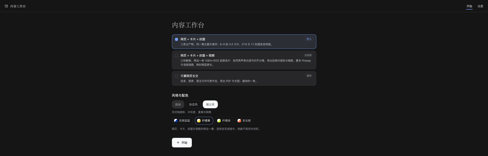

# dsh-multichannel-story

给 DeepSeek Harness（Desktop 与 Web 同一个 bundle）装上 `multichannel-story` 技能：**一篇文章 → 精排网页长文 + 小红书图文 + 公众号封面，可选再加一条带自然男声旁白的抖音竖屏视频**。

它做两件事：

1. **技能**：把仓库里那份 skill（`SKILL.md` + `references/` + `scripts/`）作为 **bundled skill provider** 注册进 `ctx.skills`。装上以后每个会话的技能目录里都有它，输入框里打 `/multichannel-story` 就能直接调用，不用再手动拷到 `~/.agents/skills/`。
2. **侧栏入口（可选）**：左侧边栏的全局面板区多一个「内容工作台」入口，点开是插件自己的页面（产物说明 + 「开始做一条内容」一键新开会话并填好 `/multichannel-story` 草稿 + 入口开关）。不想要这个入口就关掉，技能照常可用。

## 支持平台

**macOS 与 Windows 都是一等公民**：两端加载的是同一份 `client.js`、同一套 Node 脚本，代码里没有只在一个平台成立的路径假设；差别只在宿主外壳与命令行习惯。

| 平台 | 状态 | 安装 | 注意 |
| --- | --- | --- | --- |
| **macOS**（Desktop / Web） | 实测：脚本层 + 单元测试 + 真实 Web 宿主截图 | 应用内插件管理器，或 `node scripts/install.mjs`（建 symlink） | Desktop 装完要**完全退出**再打开 |
| **Windows**（Desktop / Web） | 代码路径就绪，静态检查与单测覆盖，**未在 Windows 真机跑过** | 优先应用内插件管理器；`scripts/install.mjs` 用 junction（通常不需要管理员权限；遇到 EPERM 就用应用内插件管理器） | 不要用 `bash` 跑技能脚本，统一 `node <base>/scripts/mcs.mjs`（Node 在 Windows 也认正斜杠）；文本固定 LF |
| Linux | 未验证 | 同 macOS | 不作为支持承诺 |

两个平台共同遵守的约定（都有自动化检查兜着）：

- 家目录一律用 `os.homedir()`（Windows 没有 `HOME`），`DSH_HOME` 可覆盖。
- Node 侧不通过 shell 起子进程（`spawn(cmd, args)`，不拼命令字符串）。
- 文本固定 LF、图片按二进制（插件目录的 `.gitattributes`）；MANIFEST 哈希在 CRLF 检出时也会先归一化，不会整份失配。
- 技能里的 `*.sh` 只是 POSIX 薄壳，Windows 用 `mcs.mjs`，两条路径等价（见 [references/setup.md](<assets/multichannel-story/references/setup.md>)）。

## 界面：工作台与可选入口



界面走宿主自己的面板语言（语义 token、宿主字体、衬线标题、克制动效），结构上按**行动优先**组织：

- **入口**：左侧边栏全局面板区多一个「内容工作台」（工作台图标 + 名称，排在 歸藏设计 之后）。
- **工作台**（主区域）：顶部是品牌 + 两个页签
  - **开始**：标题「内容工作台」→ **三档产物预设**（网页 + 卡片 + 封面 / 网页 + 卡片 + 封面 + 视频 / 只要网页长文，各带「默认 / 含视频 / 单页」标签与差异说明）→ **风格与配色**（不预设：默认停在「自动」，由技能先给建议；点「杂志风 / 瑞士风」才展开该风格的配色色卡，套数以「歸藏设计」插件的 `themes.json` 为准，当前杂志风 6 套、瑞士风 4 套）→ 主按钮只写「开始」（做哪一档由上面的单选组表达，按钮里不再重复；读屏名是「开始：<档位> · <风格>」）→ 成功后一行状态提示。页面刻意只留行动：导语、kicker、小节标题、CTA 旁注、右侧「开跑前会检查」与四步流程、以及提示词预览都不再渲染（预设分组的无障碍名仍保留在 `aria-label` 上）；
  - **设置**：按「分组标题 + 卡片」组织，分组标题用 `h2` + 15px（不是开始页那种 30px 页面大标题，后面再加分组时同层级往下排）。目前只有一个分组「入口与偏好」，里面是「在左侧边栏显示入口」开关。
- **风格与配色**：两段单选——风格（自动 / 杂志风 / 瑞士风，默认自动）与配色（选定风格后的该风格主题），色卡用主题自己的纸色 + 强调色对角切开预览。选择会以 `--style <id> --theme <id>` 的形式跟在产物指令后面写进草稿，技能照做、不再追问风格；停在「自动」时指令会要求技能先给 2–3 组「风格 + 配色」建议再动手。id 与「歸藏设计」插件的 `themes.json` 同一套（`assets/` 里的技能文档也列了同一张表），选一套就等于同时决定网页、卡片 seed、封面与视频 token。选择是纯 UI 偏好，存在浏览器 `localStorage`（`dsh-multichannel-story:style`），坏值或不兼容组合会回落到「自动」。
- **一键开始**：主按钮新开会话，把一段**自然语言指令**（点名 `multichannel-story` 技能 + 本次产物 + 风格与配色）写进输入框；**已有草稿时追加**而不是覆盖，也不会自动发送。刻意不用斜杠命令：宿主只在整段草稿以 `/` 开头时把它当命令裁决（`dsh-client-ui-conversation` 的 input machine），而这里会复用「空白会话」的未发送草稿，追加进去的文本不在开头，斜杠就退化成普通消息、技能不会被调用；自然语言点名在两种情况下都成立。斜杠命令仍可手动输入。打开期间按钮禁用并显示「正在打开…」，避免连点开两个会话；失败时 `role="alert"` + 「重试」，成功时给一行状态提示（会话没能打开时由宿主在会话区提示）。
- **可访问性**：页签是 `role="tablist"/"tab"` + `aria-selected` + 方向键 / Home / End；预设、风格、配色三段都是 `role="radiogroup"/"radio"` + roving tabindex，方向键 / Home / End 换档，预设读屏名只读标题、说明走 `aria-describedby`，色卡用 `aria-hidden` 的色块 + 文本名；开关 `role="switch"` + `aria-checked`，用可见文字做名字；所有实例内 id 都带 `useId` 前缀，主面板与右侧栏标签页同时挂载也不会撞 id；主要控件（页签、主按钮）高度 36–44px，开关视觉 44×24 但命中区撑到 44 高。
- **视觉约定**：所有界面颜色走 `--dsw-alias-*` 别名层（带 `color-mix` + 宿主 token 兜底）；唯一的字面色值是 `STYLES` 里的色卡数据（内容主题的纸色/强调色，用来画预览色块，不参与界面样式），`test/client.test.mjs` 会断言它只出现在那一个数据块里。圆角用 `--dsw-radius-*`、阴影用 `--dsw-elevation-soft`；支持亮/暗主题、窄窗口（≤720px 预设单列、页签整行、主按钮满宽）、`prefers-reduced-motion` 关动效；中文行宽按 34em 收，避免一行排过长。开始页是单列窄版式（max-width 660px），不再有左右两栏，因此在主区、右侧栏标签页、窄窗口下都不需要切换布局。
- **桌面窗口 chrome**：macOS 的红绿灯/隐藏标题栏不占布局高度，主区面板（`mcs-host-main`）用框架发布的 `--dsh-frame-top-clearance` / `--dsh-frame-leading-clearance` 让出顶部与左上角；Windows 的 frame 已经用 padding 让出标题栏高度，所以不再重复补。
- **开关两处**：工作台里的开关；或 **设置 → 插件 → 内容工作台 → 配置** 里的同一个开关（入口关掉后仍能重新打开）。关掉时如果正停在工作台，会自动回到会话面板，不会把人困在无入口的页面里。
- 开关与风格选择都是**纯 UI 偏好**（一个布尔值 + 一组 `{style, theme}`，存在浏览器 `localStorage`，不含任何个人信息）。DSH 0.2.2 有 Host settings 服务，但它是**跨浏览器共享**的（写进 profile 的 settings 文档）；这里要的是「每台浏览器各自记一个界面开关」，所以刻意留在客户端，不走 settings 命名空间。卸载插件后这条键不再被读取。
- **文案**：中英双语文案叶子交给宿主 `locale` 服务按回退链解析（不支持中文/英文的界面回退英文，不会显示中文）；服务缺失时才用本地兜底。
- 入口隐藏不影响技能：`/multichannel-story` 与技能目录里那一条始终可用。
- 若本机装了 `dsh-better-sidebar`，同一套工作台还会在右侧栏注册一个同名标签页（没装则自动跳过）。

## 安装

DSH 里用插件管理器装（推荐，Desktop / Web 各自的 profile 各装一次）：

```
plugin_manager(action="install_bundle", target="<本插件目录的绝对路径>")
```

或者用仓库自带的双端安装脚本（默认处理 `web` 与 `desktop` 两个 profile）：

```sh
cd <本插件目录>
node scripts/install.mjs              # 安装到 web + desktop（没有则退回全部检测到的 profile）
node scripts/install.mjs --check      # 只检查，不改文件
node scripts/install.mjs --dry-run    # 只打印计划
node scripts/install.mjs --uninstall  # 卸载
```

- **安装或升级后请完全退出并重新打开 DSH**；Desktop 仅刷新页面不会重建 bundle 列表与客户端模块。
- 装完看 **设置 → 插件** 里有没有「内容工作台」这一行（图标 + 说明 + 详情图）。
- 新会话立即可见；已打开的会话会在下一次请求时收到更新后的技能目录。
- 注意：DSH 的 **Web 与 Desktop 是两个独立 profile**，两端要分别安装（Desktop 用应用内插件管理，Web 用 `plugin_manager` 或 `scripts/install.mjs`）。本轮工作没有改任何 profile，安装前请先用 `node scripts/install.mjs --check` 看当前状态。
- 详细步骤、`DSH_HOME`、目录移动后重建链接、排障见 [INSTALL.md](INSTALL.md)。

## 兼容性与验证状态

| 项 | 值 |
| --- | --- |
| `engines.dsh` | `>=0.2.2-rc.1 <0.3.0`；本机逐条核对的是 DSH `0.2.2-rc.5` 源码（`skills.registerProvider`、`main` keyed slot、`sidebar.panellist`、`plugins.bundle.config`、`uiWorkspace.startSession`、`layout.selectPanel`、locale 的 `resolveText`/`active`）。rc.1 只按文档核对过等价性，没有实机运行 |
| 本轮安装状态 | 没有安装、卸载或修改任何 profile；界面验证用的是临时 `dsh --profile web` 实例（同一份 bundle），你的 Desktop 没有被重启。装没装请以 `node scripts/install.mjs --check` 为准 |
| Node | `>= 20`（插件运行时无第三方依赖） |
| 平台 | **macOS**（Node v26 / ffmpeg 9）：脚本层、单测、真实 Web 宿主都跑过；**Windows**：静态检查 + 单测覆盖（junction、homedir、CRLF 归一化、无 shell 调用），但没有 Windows 真机运行记录 |

已验证（本轮，可复现）：

- `node --test` 168 项（167 通过 + 1 项默认跳过的真实上游比对）；其中 `test/platform.test.mjs` 覆盖 macOS / Windows 的跨平台约定（CRLF 归一化、`.gitattributes`、家目录、无 shell 调用、junction），`test/package.test.mjs` 还会解包校验 `npm pack` 的产物没有漏文件。`node --check index.js client.js`；`node scripts/check-package.cjs .` 全绿。
- 客户端槽位/服务契约按 rc.5 源码逐条核对；macOS 窗口 chrome 安全区（`--dsh-frame-*`）与空闲状态圆点有静态回归断言；写入草稿的指令有"不能是斜杠命令"的回归断言。
- `sync-assets`：同目录/大小写/符号链接重叠保护，`--manifest-only` 重算清单（10 项测试）。
- `mcs`：`--out` 的项目内/符号链接/已存在保护、导出 argv（不打印可粘贴的 shell 命令）、`--cap-fig` 名称注入、`cards` 比例标注与校验器缺失、`brand` 缺参数、`verify` 的帧率容差/响度分析失败/语句落点、`check` 的 CLI 多级发现（30 项测试）。
- `tts.py` / `scaffold-video.py`：离线桩测 22 项（id 路径穿越与重复、`total_duration` 必填、`--out` 覆盖保护、单句重试、HTML 转义、场景校验、旁白损坏/路径越界硬失败）。
- 技能自检 `mcs preflight --page --cards` 在本机全绿；`mcs preflight --video` 只剩 edge-tts 缺失（本机确实没装），`mcs check` 能从 onboarding 清单定位到 `~/openmotion/node_modules/hyperframes/bin/hyperframes.mjs`；`mcs verify` 对真实 ffmpeg 生成的 3 秒竖屏样例做过通过与失败两侧的端到端判定（含 `--expect-cues`）；`mcs page` / `mcs cards` 用真实 `dsh-guizang-design` 跑过最小样例（页脚清理、seed 退出码 3、渲染+校验 0 fail）。

未验证（不要当成已完成）：

- Desktop（Electron 外壳）里**重启后的加载**：本轮用同一份 `client.js` 在 Web profile 的实际宿主里看过（见下一条），但 Desktop 窗口本身没有重启验证；两边加载的是同一份 bundle，差异只在宿主外壳，仍建议重启 Desktop 后自己确认一遍。
- Windows 下的渲染；better-sidebar 右侧栏标签页里的同一套选择器。

本轮已用真实宿主（`dsh --profile web`，同一份插件 bundle）在浏览器里看过并截图：

- 「开始」页新增的**风格与配色**：默认「自动」+ 一行说明；选「杂志风」出现 6 张色卡、选「瑞士风」出现 4 张；色卡用主题纸色/强调色对角预览，选中态有强调色描边。
- 暗色、亮色（用 CDP 模拟 `prefers-color-scheme: light`，不是宿主自己的亮色主题设置）两套下文字与选中态都可读；430px 窄宽度下色卡自动换行、无横向溢出（`scrollWidth === innerWidth`）、主按钮满宽。
- 选风格 / 色卡会即时更新主按钮读屏名（「开始：<档位> · <风格>」），并把选择存进 `localStorage`；写进草稿的 `--style / --theme` 由单测断言，没有在真实会话里点「开始」（避免在你的 profile 里留下一批空会话）。
- `page` / `cards` 的**完整视觉验收**（本轮用真实 `dsh-guizang-design` 跑通了最小样例：页脚清理、seed 退出码 3、渲染 + 校验 0 fail；但版式、主题、窄屏与图片加载没有逐项看过）。
- OpenMotion 工程端到端（`complete_generation` / 导出 / 成片播放）。

验证方式（不依赖截图）：客户端模块按 `window.__ModuleLoader__.load` 契约由 `test/client.test.mjs` 在假 window/React/slots 下加载并断言 slot 注册与开关行为；Host 侧用 `scripts/check-package.cjs .` 校验 `dsh.client`、`./client` 导出与主题 token 约束；技能脚本用 `node --test` 的桩测试覆盖判定与失败路径。**已打开的页面需要刷新（Desktop 需重启）才会加载新的客户端模块**——未刷新时技能照常可用，只是侧栏暂无入口。

## 它不改什么

这是刻意设计的最小侵入：

| 可能影响宿主的东西 | 本插件 |
| --- | --- |
| 覆盖 / 替换内置插件行 | 没有，只有一条 `insert` |
| 覆盖 / 替换宿主 UI 组件 | 没有；只往既有 slot 里追加自己的入口、面板与配置卡片 |
| 新增工具（占系统提示词） | 没有 |
| 改系统提示词 / 注入上下文 | 没有 |
| 监听事件（`agent/*`、`tools/*`） | 没有 |
| 客户端 UI | 一个侧栏入口 + 一个主面板 + 插件详情页的一张配置卡片；用主题 token，随插件卸载自动注销 |
| 写工作区或 profile 文件 | 没有（持久化只有两项浏览器 UI 偏好：侧栏入口布尔值、风格+配色选择） |

Host 半区唯一的行为是注册一个只读 skill provider：`list()` 返回一个缓存的候选，`get()` 返回缓存的正文，不读盘、不联网。

如实说明两件事：

- 每个会话的技能目录会多出 `multichannel-story` 这一条（大约一行目录文本），这就是它的全部 prompt 成本；停用插件后这条会消失。
- 插件以 `link:` 形式装在**它被安装的那个目录**，不要挪动或删除该目录：挪走后 profile 里的 bundle 引用会悬空，技能会直接加载失败（插件不会破坏其它行，重新指向或卸载即可）。

## 风格与配色从哪来（跟着「歸藏设计」同步）

工作台里的配色不是本插件自己定的：风格 id、配色名、纸色/强调色、每种风格的默认主题，全部来自
`dsh-guizang-design` 的 `skills/guizang-page-skill/assets/themes.json`。上游加了新主题、改了颜色或换了默认值，
跑一次同步就跟上：

```bash
node scripts/sync-themes.mjs            # 写入（npm run sync-themes）
node scripts/sync-themes.mjs --check    # 只比对，有漂移以 1 退出（npm run check-themes）
node scripts/sync-themes.mjs --source <dsh-guizang-design 目录>   # 手动指定上游（也可用 GZ_ROOT）
```

`--check` 在**没装**上游时不算漂移：打印跳过原因并以 0 退出，方便挂在没有该插件的 CI 上。
要把「没装」也当失败，加 `--require-source`。

它只改 `mcs:themes` 标记之间的内容，标记外一个字都不动；写文件是「临时文件 + rename」，中途失败不会留下半个 `client.js`：

| 目标 | 生成什么 |
| --- | --- |
| `client.js` | `STYLES` 表：风格名/说明、`defaultTheme`、每套配色的 id + 中英名 + 纸色 + 强调色 |
| `assets/multichannel-story/SKILL.md` | 第一步「风格与配色」的选项清单 |
| `assets/multichannel-story/references/page.md` | 主题表（含「适合什么内容」）与兜底说明 |

写完后会自动重算 `MANIFEST.json`。`test/sync-themes.test.mjs` 用假上游验证生成器与失败路径，**默认不比对真实上游**——
否则你升级了「歸藏设计」、还没跑同步时 `node --test` 会莫名其妙变红。要强制比对时：

```bash
MCS_REQUIRE_UPSTREAM=1 node --test test/sync-themes.test.mjs   # 仓库生成块与已装上游不一致就失败
```

两条边界：

- 上游若新增第三种骨架（不是 magazine / swiss），同步会**警告并跳过**——`mcs` 与 `render.mjs` 的 `--style` 还不认它，先适配再纳入。
- 新主题的「适合什么内容」是人工判断，生成时先填「—」并提示去 `scripts/sync-themes.mjs` 的 `THEME_NOTES` 补一句，不会拿机器话糊上去。

按同一原则，`mcs page` 不再写死默认配色：没给 `--theme` 时**不传**这个参数，由 `render.mjs` 取上游的 `default`，所以我们不会和「歸藏设计」的默认值漂移。

> **升级注意**：因为不再注入默认主题，直接调用 `mcs page` 且**不带 `--theme`** 时，杂志风现在出的是上游默认（墨水经典），不再是以前的靛蓝瓷。通过工作台或技能跑的流程一直显式带 `--theme`，不受影响；自己写了脚本调用 CLI 的话，把主题显式写上。

## 技能内容

插件里的 `assets/multichannel-story/` 是 skill 的副本：

- `SKILL.md`：流程与硬性约束（先自检 → 选工作流 → 网页 → 卡片/封面 → 视频 → 验收）
- `references/`：setup、page、cards、video、voice、copy-and-images、guizang-workflows、checklist
- `scripts/`：`mcs.mjs`（跨平台 CLI：`preflight` / `page` / `cards` / `brand` / `check` / `verify`）、`page-post.mjs`（网页后处理，纯函数、单独可测）、它的 POSIX 薄壳 `*.sh`、`tts.py`、`scaffold-video.py`、`list-recipes.mjs`
- `MANIFEST.json`：副本逐文件 sha256，用来发现"手改副本"或"同步遗漏"

Windows（DSH Desktop）上直接 `node <base>/scripts/mcs.mjs preflight --page --cards`，不要用 `bash`——那里的 `bash` 常常是 WSL。
`mcs check <工程目录>` 会按 `HYPERFRAMES_CLI` → 旧版 `install.json` → `$DSH_HOME/profiles/<profile>/openmotion-onboarding.json` → 已知安装目录 的顺序定位 hyperframes CLI（成功时打印来源，失败时列出试过的位置）。
`mcs verify <mp4>` 现在会真的核对积分响度/真峰（−16 LUFS ±1 / 真峰 ≤ −1.0 dBTP）与语句落点（`--expect-cues scenes.json`，容差 0.4s）；不给 `--expect-cues` 时会明确写「未校验语句落点」。

注意：手动安装路线用的 `scripts/install.sh` 不进插件包。装了插件后再跑它，会往 `~/.agents/skills` 拷一份 rank 500 的副本，优先级高于插件的 600，插件更新就不生效了。

## 依赖（技能会自己检查）

| 产物 | 必需 |
| --- | --- |
| 网页长文 | `dsh-guizang-design` 插件（含 `guizang-page-skill` 的 `render.mjs` / `export.mjs`）、node |
| 小红书 / 公众号封面 | `dsh-guizang-design` 插件（`render.mjs` / `validate-social-deck.mjs` / seed 模板）、可用的 playwright chromium（macOS `~/Library/Caches/ms-playwright`） |
| 抖音视频 | OpenMotion（MCP + 本机 Studio）、ffmpeg/ffprobe、python `edge-tts` |
| 抓真实网页/推文截图 | `ego-browser` |
| 免费图库配图 | `dsh-stock-images` |

缺依赖时技能会报缺并停下，不会用静音成片或纯文字卡片凑数。

## 与手工安装的 skill 共存

同名 `~/.agents/skills/multichannel-story` 存在时，**用户目录那份优先**（插件用 bundled 优先级 600，用户级是 500）。
也就是说插件不会顶掉你自己改过的副本；想只保留插件版本，把用户目录那份删掉即可。

注意：用户级副本存在时，**实际加载的是那份、不是插件里的副本**，两者的差异不会有人提示你。
所以"技能能加载"不能用来证明插件生效——要验证插件版本，必须先删掉（或临时改名）`~/.agents/skills/multichannel-story`，再重启 DSH 看技能目录。

## 开发

```bash
node scripts/sync-themes.mjs               # 从已安装的 dsh-guizang-design 同步主题表（client.js + 两份文档）
node scripts/sync-themes.mjs --check       # 上游换了主题而没同步时以 1 退出（没装上游则提示后跳过；要强制失败加 --require-source）
node scripts/sync-assets.mjs               # 从 ../multichannel-story（与本插件目录同级）同步副本 + 重建 MANIFEST.json
node scripts/sync-assets.mjs <源目录>       # 或指到别的 skill 目录（也可用 MCS_SKILL_SRC）
node scripts/sync-assets.mjs --manifest-only  # 上游源不在本机时：只按现有副本重算 MANIFEST.json
node --test                                # 单元测试：provider、客户端、安装脚本、同步、主题同步、CLI、Python、跨平台约定
node --check index.js && node --check client.js
node scripts/check-package.cjs .           # 交付前静态检查（清单/图标/详情/副本哈希/个人路径/files 存在性）
```

同步是"先校验源、复制到临时目录、再整体替换"：源不完整或源/目标重叠时会直接失败，现有副本保持不变。大小写不看平台猜——脚本会探测目标文件系统是否折叠大小写，再用 `dev+ino` 兜底，避免把「副本自己」当源删掉。

改了 skill 之后：副本可现场维护时先 `--manifest-only`（否则 `node --test` 会因为 MANIFEST 哈希不一致而失败），能拿到上游源时再跑完整 `sync-assets`；然后重启 DSH 或重新安装 bundle 让新的 `SKILL.md` 生效。

## 卸载

```
plugin_manager(action="set_bundle", target="dsh-multichannel-story", enabled=false)   # 立即停用，技能消失
plugin_manager(action="remove_bundle", target="dsh-multichannel-story")               # 彻底移除
# 或
node scripts/install.mjs --uninstall
```

## 已知限制

- 技能正文以配置的方式交给模型，插件本身不执行任何渲染：卡片/视频的实际依赖与失败模式见 `references/setup.md`。
- 插件不写日志文件、不落盘、不缓存工作区状态（只在宿主缺少 skill provider API 时输出一条警告）；所有产物由技能脚本写进用户自己的项目目录。
- 技能里的脚本会在用户机器上起 `node` / `python` / `ffmpeg` 子进程，按 DSH 的审批与沙箱策略执行。
- 图标与详情图的实际观感（尤其暗色主题）尚未目视验证，见上文验证状态。

MIT License。
