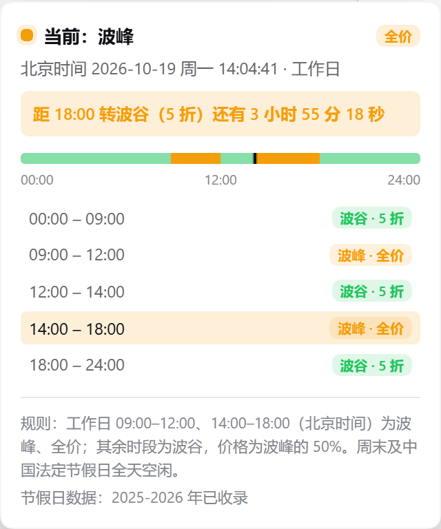

# dsh-peak-hours

在 DeepSeek Harness 的 Web / 桌面端侧边栏常驻显示 **DeepSeek API 当前处于波峰还是波谷计费时段**，不用再去翻价格页面对时间。




## 功能

- **常驻徽章**：侧边栏底部显示「波峰 / 波谷」、当前计费（全价 / 5 折）以及距下次切换的倒计时，倒计时固定精确到秒并逐秒跳动。
- **Hover 常驻卡片**：鼠标进入整行（不只胶囊本身）就弹出摘要卡片，直接复用点击面板的标题区文案与排版（「当前：波峰 / 波谷」+ 右侧计费胶囊 + 北京时间 + 带秒倒计时）；指针移到卡片上也不会消失，离开徽章和卡片才收起。不再使用会被浏览器定时收起的原生 tooltip。
- **点击看详情**：点击徽章展开完整面板，包含北京时间、今日 24 小时时段轴、逐段时段表（当前时段高亮）、下次切换时刻（同样带秒）、计费规则与节假日数据覆盖年份；面板打开时 hover 卡片自动隐藏，避免叠在一起。
- **折叠适配**：侧边栏收起为窄栏时，徽章自动变成「峰 / 谷」小方块，详情面板仍然可用。
- **双端一致**：Web 端与桌面端使用同一套前端，装进对应 profile 即可；插件不依赖任何第三方运行时依赖，也不需要构建。

## 判定规则

按北京时间（Asia/Shanghai）计算：

| 时段 | 峰谷 | 计费 |
| --- | --- | --- |
| 周一至周五 09:00–12:00、14:00–18:00（法定节假日除外） | 波峰 | 全价 |
| 工作日 12:00–14:00、18:00–次日 09:00 | 波谷 | 波峰的 50% |
| 周末全天 | 波谷 | 波峰的 50% |
| 中国法定节假日全天 | 波谷 | 波峰的 50% |

调休补班的周末仍按「周末」计为波谷；`HOLIDAYS` 收录的是国务院公布的**放假日期**（含调休放假，不含补班日），因此整个假期期间都会显示为波谷。

> 说明：如果你的理解是「只有法定节日的核心几天算节假日、调休日算工作日」，把 `HOLIDAYS` 里对应日期删掉即可，逻辑不用改。

## 安装

插件是 DSH 的 cordis bundle 包，安装即「把包链接进 profile 的 `node_modules`，并把包名加入 `dsh.profile.bundles`」。

推荐用自带安装脚本，自动处理 `web` 与 `desktop` 两个 profile（建链接、写 bundles、改前备份）：

```sh
node scripts/install.mjs
node scripts/install.mjs --check      # 验证
node scripts/install.mjs --uninstall  # 卸载
```

**换电脑 / 迁移安装**的完整步骤（含无 Node 的手动方案、`DSH_HOME`、路径搬移、FAQ）见 [INSTALL.md](INSTALL.md)。

也可以用官方 CLI 安装到 web profile（桌面端 profile 被 Electron 独占，CLI 会拒绝）：

```sh
dsh plugin --profile web add link:D:/Terry/Code/DSH/dsh-peak-hours
```

无论哪种方式，最后都要**完全退出并重新打开 DSH**（仅刷新页面不够，bundle 列表在启动时合成）。

`cordis.patch.yml` 会在启动时把 `peak-hours` 这一行插入 loader，浏览器半区由 client-modules 扫描 `package.json` 的 `dsh.client` / `exports["./client"]` 后挂载。

## 开发

纯 JavaScript，无构建步骤：

```sh
node --test         # 12 个用例：边界、节假日、跨假期、未知年份、格式化
node --check client.js
```

- `index.js`：host 半区，纯占位（不注册服务、不发系统提示）。
- `client.js`：浏览器半区，含时区换算、节假日判定、下次切换扫描、React 组件与样式注入；`window.__ModuleLoader__.load({ id, factory })` 是 DSH 客户端 bundle 的标准形态。
- 时间一律用 `Intl.DateTimeFormat` + `Asia/Shanghai` 取得，不依赖系统时区。

## 更新节假日数据

`client.js` 顶部的 `HOLIDAYS` 收录 2025–2026 年全部法定放假日期（含落在周末的日期，用于显示节日名）。国务院一般在上一年 11 月公布次年安排，届时：

1. 从 [timor.tech 节假日 API](https://timor.tech/api/holiday/year/2027) 或国务院办公厅通知取得次年 `holiday: true` 的日期；
2. 追加到 `HOLIDAYS`，例如 `"2027-01-01": "元旦"`；
3. 同步更新 `COVERAGE_YEARS` 与 `COVERAGE_LABEL`；
4. 跑 `node --test` 后重启 DSH。

未收录年份不会静默猜测：徽章仍按「工作日 09:00–12:00 / 14:00–18:00 为波峰」计算，并在详情面板用橙色提示「20xx 年放假安排尚未收录，法定节假日可能显示为波峰」。

## 兼容性

- 依赖 DSH 的 `sidebar.footer.action` 槽（0.2.x 已有）。更老的版本若没有该槽，徽章不会出现，但不会报错。
- 主题跟随 DSH 的 `--dsw-alias-*` 变量，亮色 / 暗色皮肤都能自动适配。

## 卸载

删除 profile 中 `node_modules/dsh-peak-hours` 链接、`dependencies` 与 `dsh.profile.bundles` 里的对应条目，重启 DSH。

## License

MIT
