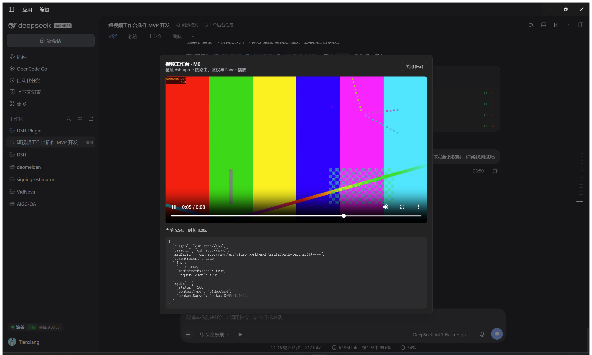

# dsh-video-workbench

DSH Desktop 的短视频制作工作台插件。**M1（骨架与播放）与 M2（渲染管线）已完成**：
TypeScript + esbuild 构建、DSH 适配层、`project.json` 项目模型、只读项目路由、`video_selfcheck`、
渲染运行时供给、渲染任务（进度/取消/超时）、成片保留与导出、浮层内渲染 UI 已就位；
素材与配音在 M3。

> **M2 状态**：`node scripts/verify.mjs` 全绿（类型、DSH 边界、构建、产物形态、产物一致、语法、158 项测试）；
> 实机渲染冒烟通过：`node scripts/render-smoke.mjs` → **10.000s / 1080×1920 / 300 帧**，约 13 秒完成，
> `renders/index.json` 与 `exportDir` 副本均生成。客户端 UI 需完全重启 DSH 后验证（见「M2 验收」）。



## 已验证

  阶段   项   结果  
  ---   ---   ---  
  v0.0.1（M0，无 token）   10s@1080p 渲染（hyperframes 0.6.33）   ✅ 15.2 秒，3.12 MB  
  v0.0.1   取消渲染   ✅ 进程树清理干净，无半成品  
  v0.0.1   `dsh-app://app` 下播放与拖动   ✅ 播放至 1.24s；拖动到 8.00s 渲染末帧  
  v0.0.2   token 注入   ✅ 完全重启后 `tokenPresent: true`  
  v0.0.2   带 token 的 `ping` / `media`   ✅ `ping` 200；media 206 + `Content-Range: bytes 0-99/1548444`  
  v0.0.2   带 token 的播放   ✅ 播放至 2.09s，画面推进（见截图）  
  v0.0.2   Esc 关闭 / 焦点归还   ✅ 关闭后焦点回到 ▶ 按钮  
  v0.0.3   重启后复测   ✅ `ping` 不再返回 `node`；token、206、播放至 1.56s 均通过  
  v0.0.4   重启后全链路复测   ✅ token、206、播放、拖动 seek、错误态与"重试"、视频聚焦时 Esc 关闭 全部通过  
  v0.1.0（M1）   类型检查 / 构建 / 产物形态 / 产物一致 / DSH 边界 / 测试   ✅ `node scripts/verify.mjs` 全绿（需产物已提交）  
  v0.1.0（M1）   运行中的 Desktop 热重载 Host 后启动自检   ✅ 5/5：路由挂载、token 一致、媒体 206、`projectsRoot` 可写、项目路由 200  
  v0.1.0（M1）   项目路由真实读取   ✅ `20261119-003934/project.json` → 200（自检内，含 `renders/v1.mp4` 样例）  
  v0.1.0 + 2026-11-19 修复 @ DSH `0.2.2-rc.5`   升级到 rc.5 后重新安装 + 启动自检   ✅ 5/5：路由挂载、token、media 206（`bytes 0-99/1548444`）、`projectsRoot` 可写、项目路由 200  
  v0.1.0 + 2026-11-19 修复 @ DSH `0.2.2-rc.5`   桌面端完全重启后的客户端验收   ✅ 全部通过：单个 ▶、`tokenPresent: true`、`media.status: 206`、播放与拖动、视频聚焦时 Esc、错误态重试；亮/暗、侧栏展开/收起、窄窗口正常；无重复浮层、无 `slot entry crashed`  
  v0.1.1   `engines.dsh` 改为 `>=0.2.2-rc.5`（自用、不设上限）+ manifest 契约测试   ✅ 产物与 0.1.0 逐字节相同（`verify` 的 artifact 校验通过），`verify` 全绿；用 DSH 自带判定函数复核：rc.5 及以后全部放行、rc.4 及更早拒绝；运行中的插件未受影响  
  v0.1.2   回归审查后的修复批次（Range 语义、场景 id 唯一性、写盘与自检加固、`nosniff`、日志脱敏等）   ✅ 本地 `verify` 全绿、158 项测试；`index.js` / `client.js` 均有变更  
  v0.2.0（M2）   运行时从零供给（hyperframes 0.6.33 + ffmpeg/ffprobe）   ✅ 真实安装成功，`supplied.json` 生成，两个二进制 `-version` 通过（约 840 MB）  
  v0.2.0（M2）   渲染任务全链路（脚手架 → 渲染 → 进度 → 产物）   ✅ `render-smoke.mjs`：300/300 帧、`10.000000s`、`1080×1920`、约 13 秒；`renders/index.json` + `exportDir` 副本正确  
  v0.2.0（M2）   取消 / 超时 / 孤儿清理 / 保留策略（假 CLI + 真机进程）   ✅ 单元与集成用例覆盖；取消后无残留进程与 `.tmp`  
  v0.2.0（M2）   浮层渲染 UI（运行时状态、安装、项目选择、进度、取消、播放成片）   ⏳ **需完全重启 DSH 后实机确认**  

> 详细数据与发现见 [docs/M0-FINDINGS.md](docs/M0-FINDINGS.md)。

## 当前能力

- `GET /api/video-workbench/ping?t=<token>`：健康检查，返回媒体目录存在性、是否要求 token、
  项目功能状态（`projects: ready   unset   invalid`）。
- `GET /api/video-workbench/media?path=<name>&t=<token>`：带 Range 的媒体读取。
- `GET /api/video-workbench/projects?path=<slug>/<file>&t=<token>`：带 Range 的**项目文件**读取
  （`project.json`、`renders/v1.mp4` 等）；`projectsRoot` 未配置时不挂载。
- `GET /api/video-workbench/selfcheck?t=<token>`：`video_selfcheck` 的 8 项检查（M2 增加运行时/浏览器/ffmpeg），
  返回 `{ ok, checks: [{ name, ok, skipped?, detail }] }`；启动 3 秒后也会自动跑一次并把结果写入
  `$DSH_HOME/cache/dsh-video-workbench/selfcheck.json`。未配置 `projectsRoot` 时两项项目检查
  标记为 `skipped`（不算失败）；运行时未安装时 `ffmpegReady` 同样 `skipped`。
- `GET /api/video-workbench/projects-list?t=<token>`：最新在前的项目列表（供渲染 UI 选择）。
- `GET /api/video-workbench/runtime?t=<token>`：渲染运行时状态（`ready   missing   installing`）。
- `POST /api/video-workbench/runtime/install?t=<token>`：安装运行时（约 840 MB，首次 2–10 分钟）。
- `POST /api/video-workbench/render?t=<token>`：发起渲染（body `{ projectId }`，并发 1，队列最多 1）。
- `GET /api/video-workbench/render/<id>?t=<token>`：轮询进度（`phase`/`percent`/`frames`）。
- `DELETE /api/video-workbench/render/<id>?t=<token>`：取消渲染并清理进程树。
- 客户端：composer 左侧 ▶ → 浮层里可「安装运行时 / 选项目 / 渲染 / 取消 / 预览成片」。

三条文件路由共用同一套实现与同一 token：

- 路径白名单：最多 5 段，拒绝 `..`、绝对路径、隐藏文件、Windows 保留字符与设备名；支持中文名。
- 符号链接逃逸会被拒绝（按 `realpath` 校验真实路径仍在根目录内）。
- 支持 `206` / `416` / `304`（`If-None-Match`、`If-Range`）、`HEAD`，其余方法 `405`。
- `Range` 只处理单个 `bytes` 段：多段、未知单位等不支持的写法按 RFC 9110 忽略该头并返回
  整个文件（200）；只有语法合法但取不到的单个范围才回 `416`。
- 所有文件响应带 `x-content-type-options: nosniff`（内容目录可被 agent 写入，避免浏览器嗅探）。

## 项目模型（M1 起）

`<projectsRoot>/<slug>/` 下：

```text
index.html          # HyperFrames 合成入口（M2 首次渲染时按 project.json 自动生成脚手架）
project.json        # schemaVersion 1：标题、画幅、fps、样式、分镜（唯一可编辑真相）
composition/        # 预留：M4 起放可复用的子合成（hyperframes 只把 index.html 当入口）
assets/             # 素材
renders/            # 成片（v1.mp4 …）+ index.json（版本、时长、宽高、字节数）
```

- slug 固定为创建时间的 `YYYYMMDD-HHmmss`，目录名即项目 id，创建后不改；标题存 `project.json`。
- 写入是原子的（临时文件 + rename）；读取先做 `schemaVersion` 迁移再校验，校验失败会返回
  可直接展示的中文错误。
- 渲染只写 `renders/`（原子 rename）；`exportDir` 只写不读，同名自动加 `-2`，失败只记日志。
- 项目 API 只导出给 Host/测试使用；客户端通过上面的路由访问。

## 鉴权

所有路由都要求 `t` 查询参数（或 `x-dsh-video-workbench-token` 头）。
token 在 Host 启动时随机生成，通过 `webserver/index-inject` 的 `global` 行注入页面
（`window.__DSH_VIDEO_WORKBENCH__.token`）；注入只面向 owner 页面，非 owner 的读者页拿不到。
页面本身需要 Host 鉴权，因此本机其它进程拿不到 token。

两点限制：

- token 放在查询串里（`<video>` 无法设置请求头），因此可能出现在浏览器历史或访问日志中；
- token 每个 Host 进程重新生成，插件热重载后旧页面会失效，需要刷新。

如需临时关闭（不推荐）：在 patch 行配置 `requireToken: false`。

## 配置（M1 / M2）

在 profile 的 `cordis.patch.yml` 里按 id 覆盖本插件的 Config：

```yaml
- id: video-workbench
  name: dsh-video-workbench
  config:
    projectsRoot: D:/Terry/Videos/dsh-video/video-projects
    exportDir: D:/Terry/Videos/dsh-video/video-exports
```

  配置项   默认   说明  
  ---   ---   ---  
  `projectsRoot`   无（必填才能启用项目功能）   所有项目的父目录；未配置时项目路由与项目检查禁用，**不会**默认写 C 盘  
  `exportDir`   无   渲染后另存成片（M2 起生效）；不通过路由暴露  
  `mediaRoot`   `$DSH_HOME/cache/dsh-video-workbench/media`   媒体演示与（M2 起）素材缓存  
  `dataDir`   `$DSH_HOME/cache/dsh-video-workbench`   插件数据目录，`selfcheck.json` 写在这里  
  `selfcheckOnStartup`   `true`   启动后自动跑一次 `video_selfcheck`  
  `selfcheckDelayMs`   `3000`   启动自检延迟（等待 web 监听绑定端口）  
  `selfcheckMediaPath`   `test.mp4`   自检探测的媒体文件（相对 `mediaRoot`）  
  `requireToken`   `true`   是否要求 token（不推荐关闭）  
  `runtimeDir`   `$DSH_HOME/cache/dsh-video-workbench/runtime`   渲染运行时安装目录（约 840 MB）  
  `chromePath`   自动探测   指定 Chrome 可执行文件；渲染必须有浏览器  
  `renderTimeoutMs`   `600000`   单次渲染超时  
  `renderWorkers`   `2`   hyperframes 并行 worker 数（每个约 256 MB）  
  `renderQuality`   `standard`   `draft` / `standard` / `high`（只影响编码，不影响时长）  
  `keepRenders`   `5`   每个项目保留的最新成片数，更旧的 `vN.mp4` 会被清理  

## 数据位置

  位置   内容   可删除  
  ---   ---   ---  
  `$DSH_HOME/cache/dsh-video-workbench/media`   媒体演示文件（`test.mp4`）   可，媒体探测会提示缺失  
  `$DSH_HOME/cache/dsh-video-workbench/selfcheck.json`   最近一次启动自检结果   可，下次启动重写  
  `<projectsRoot>/<slug>/project.json`   项目唯一可编辑真相   **不可**，备份它  
  `<projectsRoot>/<slug>/assets/`   素材与署名   **不可**，需重新下载/生成  
  `<projectsRoot>/<slug>/renders/`   成片与 `index.json`   可随时重渲染  
  `$DSH_HOME/cache/dsh-video-workbench/runtime`   hyperframes + ffmpeg/ffprobe（约 840 MB）   可，删除后需重新安装  
  `$DSH_HOME/cache/dsh-video-workbench/render-jobs`   渲染任务登记（崩溃后孤儿清理用）   可  

响应带 `Cache-Control: private, max-age=3600` 与 `ETag`。覆盖同名文件后，浏览器可能沿用旧片段，
因此渲染产物建议按版本命名（`v1.mp4`、`v2.mp4`），而不是反复覆盖同一个文件名。

## 安装

见 [INSTALL.md](INSTALL.md)。Desktop 的 profile 由应用独占管理，安装或更新前需要**完全退出 DSH**。

## M1 验收

自动化部分已通过：

```powershell
cd dsh-video-workbench
node scripts/verify.mjs              # 类型 + DSH 边界 + 构建 + 产物形态 + 产物一致 + 语法 + 测试（158）
node scripts/check-selfcheck.mjs    # 打印最近一次启动自检报告（文件不存在时退出码 1）
```

2026-11-19 已在 DSH Desktop `0.2.2-rc.5` 上完成（完全退出并重新打开 DSH 后实测）：

- **Host 自检 5/5**：`routeMounted`（匿名 401 / 带 token 200）、`tokenRequired`、`mediaProbe`
  （Range 0-99 → 206 `bytes 0-99/1548444`）、`projectsRootWritable`、`projectsRoute`（读取
  `20261119-003934/project.json` → 200）；报告在
  `$DSH_HOME\cache\dsh-video-workbench\selfcheck.json`。
- **客户端**：composer 左侧只有一个 ▶、`tokenPresent: true`、`media.status: 206`、播放与拖动、
  视频聚焦时 Esc 关闭、错误态可"重试"全部通过；亮/暗主题、侧栏展开/收起、窄窗口正常；
  无重复浮层、DevTools 无 `slot entry crashed`（单次模块注册修复生效）。
- 示例项目：`<projectsRoot>/20261119-003934/`（含 `renders/v1.mp4` 样例，可直接用项目路由播放）。

复跑：`node scripts/check-selfcheck.mjs`（新启动后约 3 秒生成报告）。

## 兼容性

- DSH：`>=0.2.2-rc.5`（无上限；下限是实测通过的版本。本插件自用、不对外分发，
  所以刻意不设上限——升级不会被门禁停用，代价是破坏性变更要靠启动自检发现，
  见 [docs/UPGRADE-PLAYBOOK.md](docs/UPGRADE-PLAYBOOK.md)）
- 平台：Windows Desktop；Web 与 macOS 未验证
- 运行时（M2 起）：需要可用的 Chrome；本机实测**优先复用系统 Chrome**，自动下载不可用
- Node：`>=20`；实测使用 DSH 托管运行时 `v24.21.0`
- 实测矩阵见 [docs/COMPAT.md](docs/COMPAT.md)

## M2 验收

自动化与 Host 侧已通过：

```powershell
node scripts/verify.mjs          # 类型 + DSH 边界 + 构建 + 产物形态 + 产物一致 + 语法 + 158 项测试
node scripts/render-smoke.mjs    # 真实渲染冒烟：10s / 1080x1920 / 300 帧（需要已安装运行时）
node scripts/check-selfcheck.mjs # 启动自检报告（应为 8 项）
```

- **运行时供给**：真实从零安装 `hyperframes@0.6.33` + `ffmpeg-static@5.2.0` + `ffprobe-static@3.1.0`
  （约 840 MB），`supplied.json` 记录二进制路径，两个二进制 `-version` 校验通过。
- **渲染**：`render-smoke.mjs` 通过任务管理器跑完 `300/300` 帧，产物 `10.000000s · 1080×1920`，
  约 13 秒（draft / 2 workers）；`renders/index.json` 记录时长、宽高、字节数；`exportDir` 生成副本。
- 剩余（需**完全退出并重开 DSH**）：浮层里的「安装运行时 / 渲染 / 取消 / 播放成片」按钮与进度条。

## 兼容性

- DSH：`>=0.2.2-rc.5`（无上限；下限是实测通过的版本。本插件自用、不对外分发，
  所以刻意不设上限——升级不会被门禁停用，代价是破坏性变更要靠启动自检发现，
  见 [docs/UPGRADE-PLAYBOOK.md](docs/UPGRADE-PLAYBOOK.md)）
- 平台：Windows Desktop；Web 与 macOS 未验证
- 渲染器：hyperframes **固定 `0.6.33`**；ffmpeg-static 5.2.0 / ffprobe-static 3.1.0
- 浏览器：需要本机 Chrome；插件会把路径经 `HYPERFRAMES_BROWSER_PATH` 传给渲染器
  （hyperframes 在 Windows 上不会自己找到系统 Chrome）
- Node：`>=20`（渲染子进程要求 **≥22**，实测使用 DSH 托管运行时 `v24.21.0`）
- 实测矩阵见 [docs/COMPAT.md](docs/COMPAT.md)

## 已知限制

- 合成脚手架是纯 CSS + 最小 timeline 契约对象：可渲染、可 seek，但样式朴素；M3/M4 会替换成真正的
  HyperFrames 模板（agent 可整份重写 `index.html`）。
- 渲染并发 1（排队 1 个）；10 秒 draft 片约 13 秒，standard/high 更慢。
- 浮层是全屏模态；界面文案暂为中文硬编码；macOS 未适配。

## 开发

```sh
node scripts/build.mjs        # src/ → 根目录 index.js / client.js
node scripts/verify.mjs       # 一条命令跑完全部检查
node --test                   # 只跑测试（158 项）
node scripts/render-smoke.mjs # 真实渲染冒烟（需要运行时）
```

## 未完成

M3（素材与配音）、M4（Agent 工具主路径）、M5（微调工作台）、M6（交付打磨）见 [PLAN.md](PLAN.md)；
M2 的执行细节与被推翻的假设见 [docs/M2-PLAN.md](docs/M2-PLAN.md)；
下一个人/下一个会话请先读 [docs/HANDOFF.md](docs/HANDOFF.md)。
