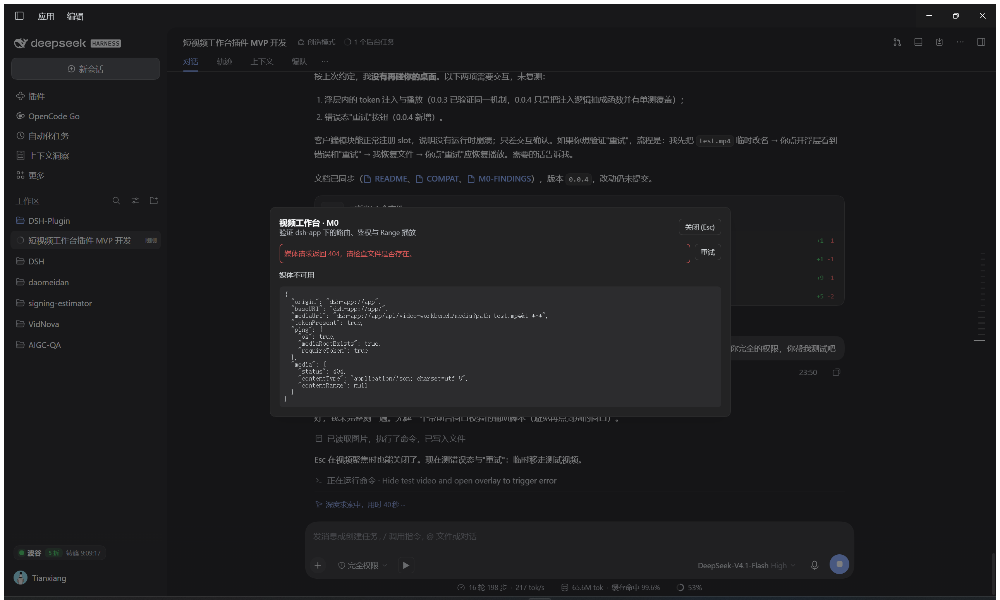

# M0 链路验证结论

日期：2026-11-18
环境：Windows · DSH Desktop `0.2.2-rc.3` · 托管 Node `v24.21.0` · hyperframes `0.6.33`

## 结论一览

| # | 验证项 | 结果 | 证据 |
| --- | --- | --- | --- |
| 1 | 托管 Node 跑本地安装的 hyperframes | ✅ | `doctor` 全绿（Node/FFmpeg/FFprobe/Chrome 路径） |
| 2 | 10s@1080p 渲染 | ✅ 15.2s | `out-draft.mp4` 3.12 MB，ffprobe 时长 10.00s |
| 3 | 取消渲染与进程清理 | ✅ | Chrome 22→32→22，node 已退出，无半成品文件 |
| 4 | Host 路由可达（v0.0.1，无 token） | ✅ | `GET /api/video-workbench/ping` → 200 |
| 5 | Range / 206（v0.0.1） | ✅ | `Range: bytes=0-99` → 206，`Content-Range: bytes 0-99/1548444` |
| 6 | 客户端半区加载 | ✅ | `conversation.input.left` 出现 `video-workbench-trigger`（active） |
| 7 | `dsh-app://` 下播放与 seek | ✅ | 见 [m0-overlay.png](m0-overlay.png)：`origin: dsh-app://app`、`status: 206`、播放至 0:01、拖动至 0:08 |

## 关键发现

### 1. pnpm 默认拦截原生模块构建（会影响每个新环境）

`pnpm add hyperframes` 会跳过 `esbuild` / `ffmpeg-static` / `onnxruntime-node` / `sharp` 的 postinstall，
导致 `ffmpeg-static/ffmpeg.exe` 不存在，渲染直接失败。

- `pnpm-workspace.yaml` 里的 `onlyBuiltDependencies` 在 pnpm 11.28 **没有生效**；
- 非交互环境下有效的做法是 `pnpm add ... --allow-build=<pkg>`（逐个列出）。

**M2 供给策略**：安装后用同一组 `--allow-build` 参数重跑一次 `pnpm add`，并校验二进制真实存在。

### 2. Chrome 自动下载在当前网络不可用（阻断级）

`hyperframes browser ensure` 在 15 分钟内零进度，缓存目录 0 MB；而 `browser path` 仍会打印一个
并不存在的路径，`doctor` 也只检查目录——**三者都会给出"看起来正常"的假象**。

**M2 供给策略**：优先复用已安装的 Chrome（`HYPERFRAMES_BROWSER_PATH`），下载仅作为可选后备；
自检必须 `fs.existsSync(浏览器可执行文件)`，不能相信 `doctor`。

已验证可用的浏览器：`C:\Program Files\Google\Chrome\Application\chrome.exe`。

### 3. 插件路由不受 Host 鉴权保护

`/api/video-workbench/ping` 无需 cookie 即可访问（DSH 自身路由 `/` 返回 401）。
桌面外壳转发时会注入 cookie，所以浏览器侧没问题；但这意味着**本机任意进程都能读插件路由**。

**M2 策略**：只暴露 `projectsRoot` 内的媒体；不提供列举、写操作路由；README 说明这是本机接口。

### 4. 客户端半区需要重启才进入模块图

插件通过应用内管理器 `link:` 安装后，Host 半边立即生效（路由可用），但客户端 slot 在重启前没有出现，
说明客户端图只在启动时合成。

**流程**：Host 改动可热应用；**客户端改动必须完全退出 DSH 再打开**。

注意：`/plugins/<包名>/client.js` 不是可用的探测地址（重启后客户端已加载，该路径仍是 404），
判断客户端是否生效应看 slot 占用或界面，不要看这个 URL。

### 5. 可用的环境变量（用于供给与隐私）

| 变量 | 用途 |
| --- | --- |
| `HYPERFRAMES_BROWSER_PATH` | 指定浏览器可执行文件，跳过下载 |
| `HYPERFRAMES_NO_AUTO_INSTALL` | 禁止自动下载 |
| `HYPERFRAMES_NO_TELEMETRY` | 关闭匿名遥测（默认开启遥测） |
| `HYPERFRAMES_NO_UPDATE_CHECK` | 关闭更新检查 |
| `HYPERFRAMES_EXTRACT_CACHE_DIR` / `HYPERFRAMES_FONT_CACHE_DIR` | 迁移解压/字体缓存 |

### 6. 缓存落在用户目录

Chrome（下载后）、字体、TTS 模型默认在 `~/.cache/hyperframes`（已含 Kokoro 310 MB、voices 27 MB）。
与本计划"数据放 `$DSH_HOME/cache/dsh-video-workbench`"不一致。

**M2 决策**：接受现状并在 README 说明，或用 `*_CACHE_DIR` 变量把可迁移的部分指到插件目录；
Chrome 缓存位置暂无可控变量，只能通过 `HYPERFRAMES_BROWSER_PATH` 绕过。

## 对里程碑的影响

- **M2**：供给脚本必须做四件事——安装、放行构建、校验二进制、复用已有浏览器；自检不能信 `doctor`。
- **M1**：`video_selfcheck` 要先校验浏览器与 ffmpeg 的真实存在，再报"可渲染"。
- **M4**：进度可从 `Capturing frame N/M` 解析，不必依赖 JSON 输出。
- **安全**：路由无鉴权这一点要写进 README 与安全清单。

## 重启后的验证结果

2026-11-18 完全退出并重开后：

1. ✅ composer 左侧出现 ▶ 按钮（`video-workbench-trigger`，active）；
2. ✅ 浮层打开，视频渲染首帧，控件显示 `0:00 / 0:08`；
3. ✅ 诊断区：`origin: "dsh-app://app"`、`baseURI: "dsh-app://app/"`、`mediaUrl: "dsh-app://app/api/..."`、`media.status: 206`、`contentRange: bytes 0-99/1548444`；
4. ✅ 播放：`当前 1.24s`，画面时间码推进；
5. ✅ 拖动进度条：跳到 `0:08`、`当前 8.00s`，画面更新为末帧——证明 Range 逐段读取可用；
6. ⚠️ Esc 关闭：**视频控件持有焦点时不生效**，点击卡片空白处后再按 Esc 才关闭。

## M0 暴露的两个 UX 缺陷（已在 v0.0.2 修复）

1. **Esc 被视频控件吞掉**：`window.addEventListener('keydown', ...)` 是冒泡阶段，
   原生 media 控件在焦点内会先处理 Escape。改为捕获阶段注册（`addEventListener(..., true)`），
   或在浮层容器上加 `onKeyDown`。
2. **关闭后不归还焦点**：打开时聚焦了关闭按钮，但关闭时没有把焦点还给触发按钮。
   记录 `document.activeElement`，关闭时恢复。

## 结论

M0 的四条链路全部打通：渲染、路由、Range 播放、取消清理。
技术风险从"未知"降为"已知的工程细节"，可以进入 M1。

## 审查后的修复记录（v0.0.2）

| 问题 | 修复 | 验证 |
| --- | --- | --- |
| 媒体路由无鉴权 | Host 生成随机 token，经 `webserver/index-inject` 注入页面；路由校验 `t` 参数（时序安全比较） | `test/media.test.mjs` 401 用例 |
| Esc 被视频控件吞掉 | 改为捕获阶段监听，并 `preventDefault`/`stopPropagation` | ✅ 页面刷新后实测可关闭；视频聚焦场景待 token 生效后复测 |
| 焦点不归还 / 无焦点陷阱 | 记录 `activeElement`，关闭时恢复；Tab 在卡片内循环 | ✅ 关闭后焦点回到 ▶ 按钮（截图可见焦点环） |
| 遮罩用弹层表面色导致整屏不透明 | 改为 `color-mix(in srgb, var(--dsw-alias-bg-base) 55%, transparent)` | ✅ 实测背景可见，不再是整屏实色 |
| 焦点环 token 不存在 | 改用 `--dsw-alias-brand-primary` | ✅ 实测焦点环可见 |
| `no-store` 导致重复下载 | 改为 `private, max-age=3600` + `ETag` / `If-None-Match` / `If-Range` | 304 用例 |
| HTTP 处理逻辑无测试 | 导出 `createMediaHandler` / `createPingHandler`，新增 13 个集成用例 | `node --test` 21 项全过（当时） |
| 文件名白名单拒绝中文 | 改为字符拒绝表 + `path.relative` 包含校验，允许中文与空格 | Unicode 用例 |
| 符号链接逃逸 | `realpath` 后再次校验包含关系 | junction 逃逸用例 |
| 文档与实现不一致（Chrome） | README 改为"M2 起"的表述 | — |
| 缺 locale / scripts / INSTALL / LICENSE | 全部补齐，`package.json` 增加 `scripts` 与 `files` | — |
| `ping` 暴露绝对路径 | 只返回 `mediaRootExists` 与 `requireToken` | ping 用例 |
| `<style>` 嵌在 `<button>` 内 | 改为 Fragment 并列渲染 | — |
| 字面 `rgba` 阴影 | 去掉 fallback，只用 token | — |
| Web 前缀下绝对路径失效 | 工厂期捕获 `APP_BASE`，相对解析 | — |

### v0.0.2 鉴权链路验证（2026-11-18，完全重启后）

用页面浮层实测：

1. ✅ `tokenPresent: true`——`window.__DSH_VIDEO_WORKBENCH__` 已由 `webserver/index-inject` 注入；
2. ✅ `media.status: 206`、`contentRange: bytes 0-99/1548444`；
3. ✅ 播放：`当前 2.09s`，画面时间码推进；
4. ✅ Esc 关闭后焦点回到 ▶ 按钮；
5. ⏳ 带 token 的拖动未重测（v0.0.1 已用同一路径验证过 seek）。

页面刷新不足以重新采集 `injections`：Desktop 外壳在应用启动时调用一次
`collectIndexInjections(browserPeer)` 并缓存结果。因此 token 只在**完全重启**后更新。

### v0.0.3 内部改动（已重启复测）

| 问题 | 修复 |
| --- | --- |
| token 注入未按 Peer 过滤 | 只对 `peer.principal.kind === 'owner'` 注入 |
| `mediaRootReal` 只在构造时快照 | 改为每次请求 `realpath` 根目录（目录后建 / junction 重定向也能正确判断） |
| 304 携带 `content-type`；HEAD + `If-None-Match` 不返回 304 | 304 用最小头集；HEAD 同样返回 304 |
| ETag 只有 size + mtime | 加入 ctime，降低同尺寸快速覆盖的命中概率 |
| `<style>` 被注入两份 | 改为 `apply` 中注入一次，随插件卸载清理 |
| `ping` 暴露 `process.version` | 移除 |

重启后复测（2026-11-18）：

1. ✅ `ping` 响应只剩 `{ ok, mediaRootExists, requireToken }`，确认运行的是 0.0.3；
2. ✅ `tokenPresent: true`、`media.status: 206`；
3. ✅ 播放至 1.56s，画面推进；
4. ✅ 单测 26 项通过（当时）。

### v0.0.4 审查后修复

| 问题 | 修复 |
| --- | --- |
| Peer 过滤无测试 | 抽出 `createIndexInjector(token)`，新增 owner / 非 owner / 无 peer 三个用例 |
| `MAX_SEGMENTS = 3` 与 M1 目录边界冲突 | 放宽到 5（`<project>/assets/scene/01.png` 可用） |
| 视频错误态无恢复路径、meta 显示旧值 | 加"重试"按钮（重挂载 video 并重跑诊断）；错误时 meta 显示"媒体不可用" |
| `If-None-Match` 只认精确值 | 抽出 `matchesEtag`，支持 `W/` 前缀与逗号列表 |
| `ping` 的 header token 无测试 | 补用例 |
| `mediaRoot` 可指向盘符根 | `apply` 检测到文件系统根时回退到默认目录并记录错误 |
| junction 用例静默跳过 | 改为 `t.skip` |
| 两个 handler 工厂重复构造 context | 抽出 `createContext` |
| 安装脚本每次留备份 | 新增 `--no-backup` |
| 测试偶发失败（约 1/50） | 定位为 `fetch` 连接池与临时端口复用的竞争：测试改用 `node:http` + `agent: false`（每请求一连接），并保留 `closeAllConnections` / `rmSync` 重试；100 轮串行 + 60 轮并发 0 失败 |

重启后只读自检（2026-11-18 23:48 重启，23:45 改完）：

1. ✅ 进程启动时间晚于 `index.js` / `client.js` 的修改时间，确认加载的是 0.0.4；
2. ✅ `/api/video-workbench/ping` 与 media 均返回本插件的 401 JSON；
3. ✅ `conversation.input.left` 内 `video-workbench-trigger` 为 active；
4. ✅ 33 项单测连跑 10 轮全过。

### v0.0.4 交互复测（2026-11-18 23:50，授权桌面操作）

| # | 场景 | 结果 |
| --- | --- | --- |
| 1 | 打开浮层 | ✅ `tokenPresent: true`、`ping.ok: true`、`media.status: 206`、视频首帧渲染 |
| 2 | 播放 | ✅ 播放至 1.54s，画面时间码推进 |
| 3 | 拖动 seek | ✅ 拖到 `5.54s`（`0:05 / 0:08`），画面跳到对应帧 |
| 4 | 视频聚焦时按 Esc | ✅ 浮层关闭，焦点回到 ▶（捕获阶段监听有效） |
| 5 | 媒体文件缺失 | ✅ 显示"媒体请求返回 404"、meta 变"媒体不可用"、出现"重试"按钮 |
| 6 | 恢复文件后点"重试" | ✅ 视频重新挂载，诊断回到 206，播放恢复 |

操作方式：用带前台窗口校验的辅助脚本（`AppActivate` + 校验 `GetForegroundWindow`），
避免点击落到其它窗口；测试期间临时把 `test.mp4` 改名为 `.off`，恢复后删除备份。

## 2026-11-19：客户端数据损坏事故后的加固（随 v0.1.1 发版）

背景：M1 客户端接入调试期间出现过 **DSH 客户端数据损坏**，已由用户修复，环境随后重置
（desktop profile 里插件与配置都不在了，重启验收前要重新安装）。事故与下面几处加固相关；
无论直接根因是哪一处，同一类"重复写入 / 非原子写入"风险都已处理：

| 问题 | 风险 | 修复 | 守护 |
| --- | --- | --- | --- |
| 客户端 bundle 对同一 `id` 注册两次 | 重复挂载、模块表/客户端状态异常 | 构建脚本只注册一次并返回 `export default` 插件对象；删除 `src/client/adapters/loader.ts` | `verify` 产物形态（`loadCount === 1`）+ `test/client-bundle.test.mjs`（真实产物进 VM，工厂执行后仍断言只注册一次） |
| `install.mjs` 直写 profile `package.json` | 进程中断或应用退出回写会截断 profile（客户端最重要的本地状态） | 临时文件 + `rename` 原子写；卸载后读回校验；`--profile` 名限制在 profiles 目录内 | `test/install.test.mjs`：临时 `DSH_HOME` 下 `--check`/`--dry-run`/安装/卸载/路径逃逸，断言无 `.tmp-*` 残留 |
| 写 `project.json` 失败留下空项目目录；`writeProject` 不建子目录 | 目录像项目却没有 `project.json`，后续读取报错 | 抽 `createProjectLayout` / `persistProject`，只清理本次新建的目录 | `writeProject` 布局与盘符根守卫用例 |
| `If-None-Match` 未先于 `Range` 评估 | 带缓存校验的 Range 请求返回 206 而非 304，缓存语义不一致 | 先判 `If-None-Match`（RFC 7232 §6） | 304-over-Range / 304-over-416 用例 |
| Windows 设备名（`con` / `aux` / `com1`…）可被放行 | 在 Windows 上无法创建或行为异常 | `paths.ts` 新增 `isReservedName`，媒体与项目资产校验共用 | 设备名用例（含 `com10` / `console` 反例） |

测试从 65 项增至 86 项（含安装脚本与项目失败路径用例）；`verify` 新增"产物形态"检查（构建标记、
classic JSX、单次注册、`id` 与包名一致、Host 产物可按 ESM 导入并导出 `apply`），
且"产物一致"改为对 `HEAD` 校验，只暂存不算提交。
